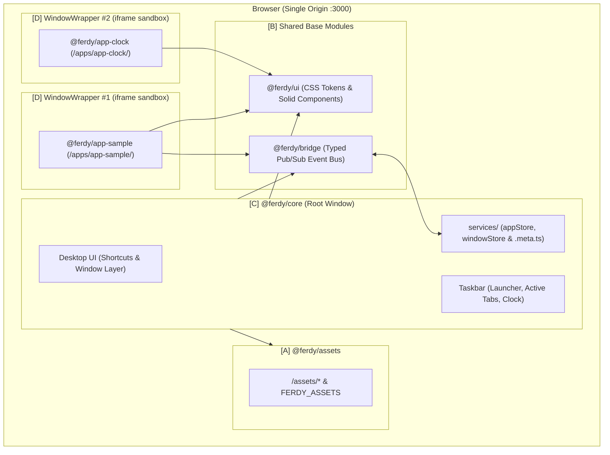

# Architecture Guide

이 문서는 **Ferdy Platter (FerdyOS)**의 **A-B-C-D-E 모노레포 계층 구조**, Single-Server MPA 동작 원리, 공통 디자인 시스템(`@ferdy/ui`), 그리고 이벤트 브릿지(`@ferdy/bridge`) 설계를 설명합니다.

---

## 1. A-B-C-D-E 계층 구조 (Layered Monorepo Architecture)

`packages/` 하위는 알파벳 순서(**A → B → C → D → E**)가 곧 아키텍처의 역할과 계층을 나타내도록 설계되어 있습니다.

| 계층 | 디렉토리 | 패키지명 | 역할 |
| :--- | :--- | :--- | :--- |
| **[A] Assets** | `packages/assets` | `@ferdy/assets` | OS 전역에서 공유하는 정적 파일(`public/assets/*`) 및 아이콘/경로 상수(`FERDY_ASSETS`) |
| **[B] Base** | `packages/base/ui` `packages/base/bridge` | `@ferdy/ui` `@ferdy/bridge` | 모든 패키지의 기반이 되는 디자인 시스템(토큰, Base CSS, Solid 컴포넌트) 및 `postMessage` Pub/Sub 브릿지 |
| **[C] Core** | `packages/core` | `@ferdy/core` | Web OS 데스크탑, 태스크바, 앱 레지스트리(`appStore`), 윈도우 매니저(`windowStore`) 및 단일 Vite 서버 MPA 게이트웨이 |
| **[D] Domains** | `packages/domains/*` | `@ferdy/app-*` | `<iframe sandbox>` 내부에서 독립된 인스턴스로 실행되는 개별 도메인 웹 애플리케이션 |
| **[E] Etc** | `packages/etc` | - | 실험적 기능, 외부 연동 어댑터, 기타 보조 스크립트를 위한 확장 공간 |

---

## 2. Single-Server MPA 아키텍처 (`packages/core/vite.config.ts`)

일반적인 마이크로 프론트엔드나 `iframe` 기반 프로젝트는 앱마다 별도의 개발 서버 포트(`:3001`, `:3002`...)를 띄워야 하는 번거로움이 있습니다.  
Ferdy Platter는 `packages/core/vite.config.ts`의 `monorepoDomainsGatewayPlugin`을 통해 **단일 Vite 서버(`:3000`)에서 모든 도메인 앱과 공용 에셋을 서빙**합니다.

### 2.1 개발 환경 (On-Demand Dev Gateway)
1. Core 내부의 `iframe`이 `/apps/<app-name>/` 경로를 요청합니다.
2. `monorepoDomainsGatewayPlugin` 미들웨어가 요청을 가로채어 `packages/domains/<app-name>/index.html` 파일을 읽어들입니다.
3. HTML 내부의 상대 스크립트 경로(`./src/index.tsx` 등)를 Vite 파일시스템 서빙 경로인 `/@fs/<절대경로>/src/index.tsx`로 치환한 뒤 `server.transformIndexHtml`을 거쳐 반환합니다.
4. `publicDir`이 `packages/assets/public`으로 지정되어 있어, Core와 모든 `iframe` 앱이 `/assets/...` 정적 리소스를 동일 오리진에서 즉시 공유합니다.

### 2.2 프로덕션 빌드 및 코드 공유 (Shared Chunks)
1. `npm run build` 실행 시 `packages/domains/*` 하위 폴더들을 자동으로 스캔하여 `dist/apps/<app-name>/index.html` 멀티페이지 엔트리로 번들링합니다.
2. 각 `iframe`은 런타임에 독립된 DOM/JS 인스턴스로 격리 실행되지만, 빌드 시 Rollup이 `solid-js`, `@ferdy/ui`, `@ferdy/bridge`를 **공통 청크(`dist/assets/...`)로 자동 추출**하므로 네트워크 다운로드는 1회(브라우저 캐시 공유)만 발생합니다.

---

## 3. 중앙 디자인 시스템 (`@ferdy/ui`)

`iframe` 경계 너머로는 부모 창의 CSS가 자동 상속되지 않으므로, 모든 패키지(`@ferdy/core`, `@ferdy/app-*`)가 `@ferdy/ui`를 import하여 동일한 Look & Feel을 구성합니다.

- **CSS Cascade Layers (`index.css` & `fdStyle.*.css`)**:
  - `@layer reset, tokens, theme, libraries, base, layout, components, utilities;` 계층 구조를 통해 스타일 우선순위를 제어하며, `index.css`를 제외한 모든 스타일시트는 `fdStyle.` 접두어를 사용합니다.
  - `fdStyle.reset.css` (`reset`): 전역 Box-sizing/Margin 리셋
  - `fdStyle.tokens.css` (`tokens`): `--fd-radius-*`, `--fd-font-*` 등 테마 비의존 기본 토큰
  - `fdStyle.theme.css` (`theme`): `--fd-primary*` (빈티지 오렌지 브라운), `--fd-secondary*` (포레스트 그린), `--fd-bg-*`, `--fd-text-*` 등 테마 시맨틱 토큰
  - `fdStyle.libraries.css` (`libraries`): 외부 오픈소스/서드파티 CSS(`lucide-static` 등) 전용 계층
  - `fdStyle.base.css` (`base`), `fdStyle.layout.css` (`layout`), `fdStyle.components.css` (`components` 공통 규칙), `fdStyle.utilities.css` (`utilities`)로 역할을 분리
- **SolidJS Primitives (`src/components/<name>/fdCompo.<name>.*`)**:
  - 각 컴포넌트는 `components/button/`, `components/badge/`, `components/card/`, `components/icon/` 폴더 안에 `fdCompo.<name>.tsx`와 `fdCompo.<name>.css` (`@layer components`)로 Co-location(근접 배치)됩니다.
  - 소문자 네임스페이스 `<fd.Button>`, `<fd.Badge>`, `<fd.Card>`, `<fd.Icon>` 및 `<FdButton>` / `<Button>`, `<FdBadge>` / `<Badge>`, `<FdCard>` / `<Card>`, `<FdIcon>` / `<Icon>` 컴포넌트 제공 (`splitProps` / `mergeProps` 기반으로 SolidJS 반응성 규칙 준수)

---

## 4. Core ↔ Domain App 이벤트 브릿지 (`@ferdy/bridge`)

각 도메인 앱은 Core의 내부 스토어(`windowStore`)를 직접 참조하지 않고, `@ferdy/bridge`의 `ferdyBridge` 객체를 통해 Pub/Sub 방식으로 통신합니다.

### 정의된 이벤트 규격 (`FerdyEventMap`)

| 이벤트 `type` | 방향 | 페이로드 필드 | 동작 설명 |
| :--- | :--- | :--- | :--- |
| `FERDY_APP_PING` | App → Core | `instanceId: string`, `timestamp: string` | 자식 앱이 정상 동작 중임을 Core에 알리는 핑 이벤트 |
| `FERDY_OPEN_WINDOW` | App → Core | `id?`, `appId?`, `title?`, `appUrl?`, `icon?`, `queryParams?`, `x?`, `y?`, `width?`, `height?` | 자식 앱 내부에서 Core에게 새로운 창 생성을 요청 (`appId` 지정 시 레지스트리 기본값 활용) |
| `FERDY_THEME_CHANGE` | Core → Apps | `theme: 'dark' \| 'light'` | Core에서 열린 모든 `iframe` 앱으로 테마 변경을 브로드캐스트 |
