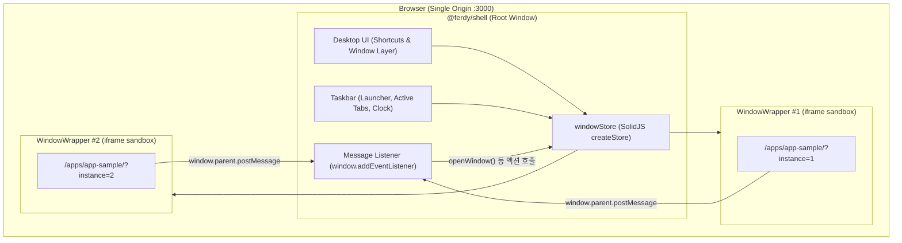

# Architecture Guide

이 문서는 **Ferdy Platter (FerdyOS)**의 전체 아키텍처, Single-Server MPA 동작 원리, 윈도우 매니저 설계, 그리고 Shell과 App 간의 통신 프로토콜을 설명합니다.

---

## 1. 시스템 개요 (High-Level Architecture)

Ferdy Platter는 브라우저 탭 하나를 데스크탑 OS처럼 사용하는 **Web OS**입니다.  
단일 모노레포 안에서 OS 환경을 제공하는 **Shell (`@ferdy/shell`)**과, 각 창 내부에서 독립적으로 실행되는 **App (`@ferdy/app-*`)**들로 분리되어 있습니다.

---

## 2. Single-Server MPA 아키텍처

일반적인 마이크로 프론트엔드나 `iframe` 기반 프로젝트는 앱마다 별도의 개발 서버 포트(`:3001`, `:3002`...)를 띄워야 하는 번거로움이 있습니다.  
Ferdy Platter는 `packages/shell/vite.config.ts`의 커스텀 설정을 통해 **단일 Vite 서버(`:3000`)에서 모든 앱을 온디맨드로 서빙**합니다.

### 2.1 개발 환경 (`monorepoAppsGatewayPlugin`)
1. Shell 내부의 `iframe`이 `/apps/<app-name>/` 경로를 요청합니다.
2. `monorepoAppsGatewayPlugin` 미들웨어가 요청을 가로채어 `packages/apps/<app-name>/index.html` 파일을 읽어들입니다.
3. HTML 내부의 상대 스크립트 경로(`./src/index.tsx` 등)를 Vite의 파일시스템 서빙 경로인 `/@fs/<절대경로>/src/index.tsx`로 동적 치환한 뒤 `server.transformIndexHtml`을 거쳐 반환합니다.
4. 덕분에 **창이 실제로 열릴 때만(On-Demand)** 해당 앱의 모듈이 컴파일/로드되며, HMR(Hot Module Replacement)도 단일 서버에서 그대로 동작합니다.

### 2.2 프로덕션 빌드 (`getAppsBuildInputs`)
1. `vite build` 실행 시 `packages/apps/*` 하위 폴더들을 자동으로 스캔합니다.
2. `index.html`이 존재하는 모든 앱을 Rollup의 멀티페이지 엔트리(`rollupOptions.input`)에 자동 등록합니다.

---

## 3. Window Manager 상태 관리 (`windowStore.ts`)

윈도우 매니저는 드래그와 리사이징처럼 초당 수십 번 발생하는 포인터 이벤트를 부드럽게 처리해야 합니다. 이를 위해 **SolidJS의 Fine-grained Reactivity**를 적극 활용합니다.

- **상태 구조 (`WindowStoreState`)**:
  - `windows`: 열려 있는 `WindowInstance` 배열 (`id`, `title`, `appUrl`, `x`, `y`, `width`, `height`, `zIndex`, `isFocused`, `isMinimized`, `isMaximized`)
  - `activeWindowId`: 현재 포커스된 창의 ID
  - `topZIndex`: 새 창이나 포커스 전환 시 부여할 최상단 Z-Index 카운터
- **성능 최적화**:
  - 창 목록 렌더링에는 `<For each={windowStore.state.windows}>`를 사용하여 배열 요소가 추가/삭제될 때 기존 창의 DOM이나 `iframe`이 리로드되지 않도록 보장합니다.
  - 창 이동 시 `left`/`top` 대신 GPU 가속이 적용되는 `transform: translate3d(x, y, 0)`를 사용합니다.
  - 드래그/리사이즈 중이거나 비활성 상태인 창에는 `.os-window-iframe-shield` 투명 오버레이를 씌워 `iframe`이 마우스 이벤트를 삼키는 문제를 방지합니다.

---

## 4. Shell ↔ App 통신 프로토콜 (`postMessage`)

각 앱은 `<iframe sandbox="allow-scripts allow-same-origin allow-forms allow-modals">` 내부에서 격리 실행되므로, 부모 창의 전역 변수를 직접 수정하는 대신 표준 `window.postMessage` API를 사용합니다.

### 현재 정의된 메시지 타입 (App → Shell)

| 메시지 `type` | 페이로드 필드 | 동작 설명 |
| :--- | :--- | :--- |
| `FERDY_APP_PING` | `instanceId: string`, `timestamp: string` | 자식 앱이 정상 동작 중임을 Shell 콘솔에 알리는 핑 메시지 |
| `FERDY_OPEN_WINDOW` | `title?: string`, `appUrl?: string` | 자식 앱 내부에서 Shell에게 새로운 창을 열어달라고 요청 |

> 향후 테마 동기화, 알림(Notification) 호출, 클립보드/데이터 공유 등의 시스템 콜이 추가될 때 `FERDY_*` 네임스페이스를 확장하여 사용합니다.

